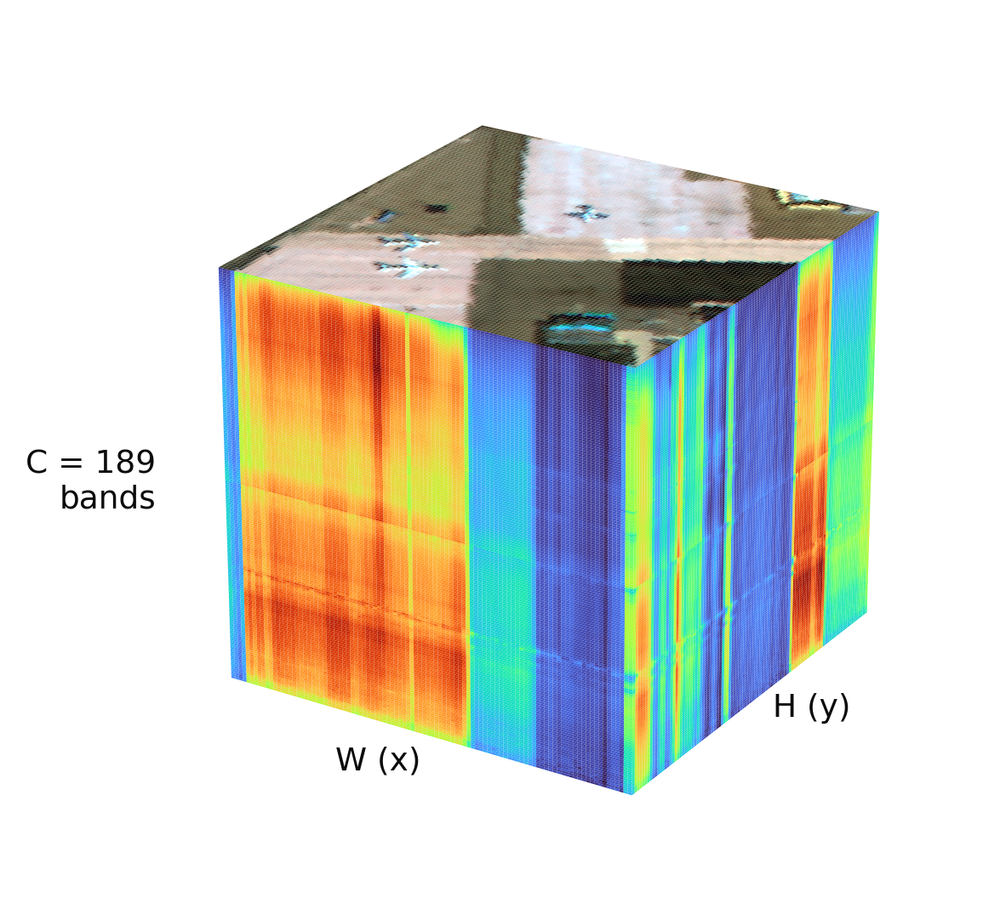
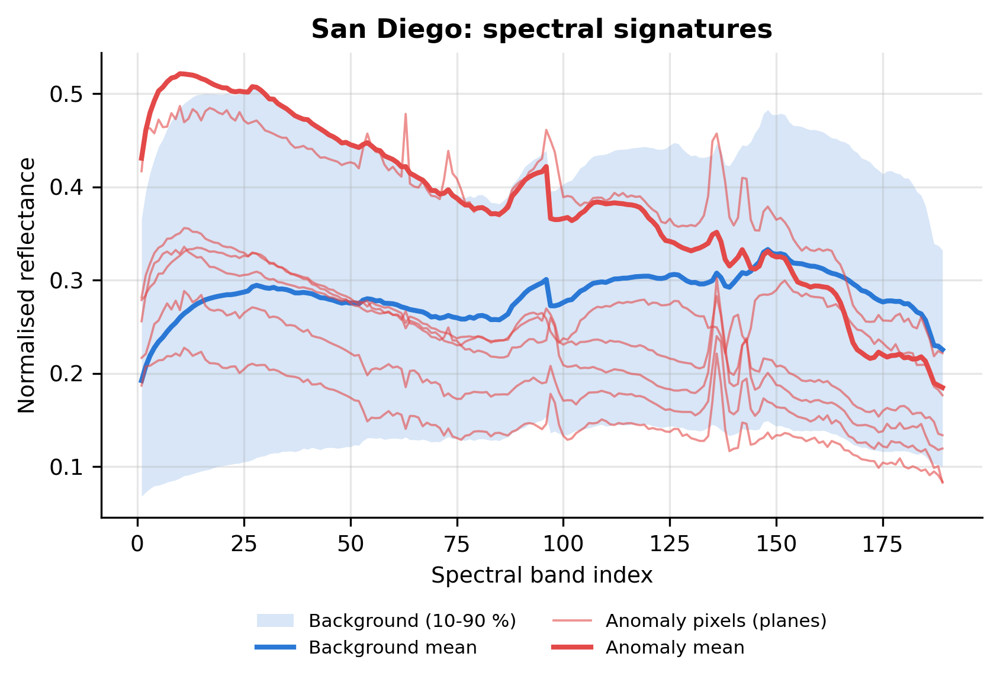
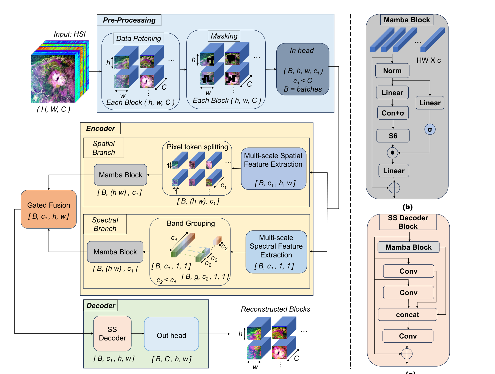
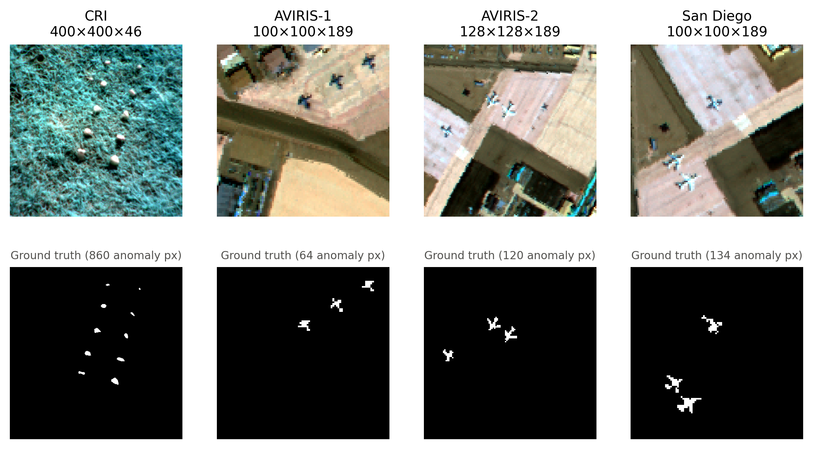
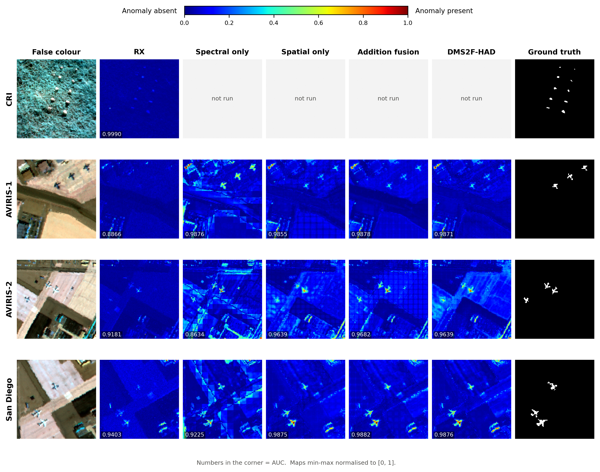
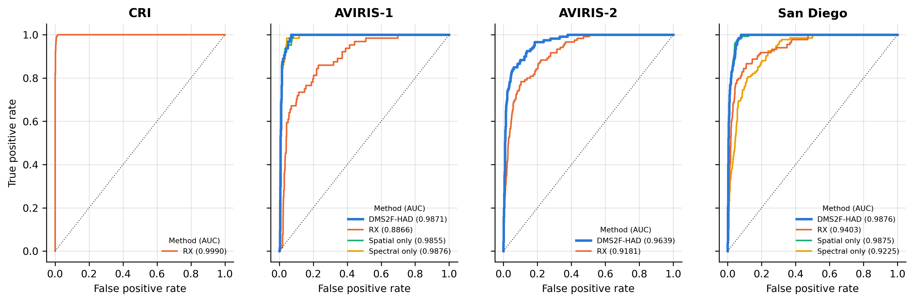
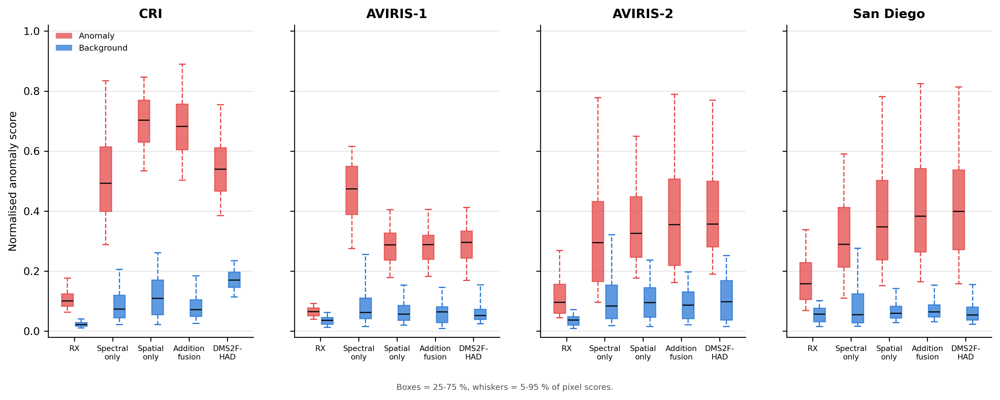
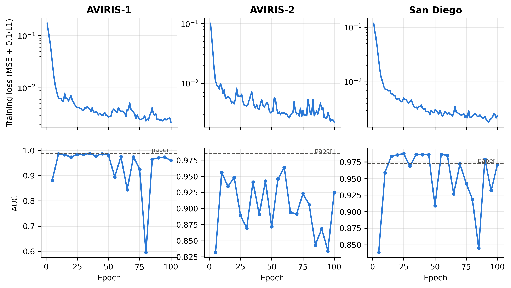

# Hyperspectral Anomaly Detection with DMS2F-HAD

A simple, self-contained PyTorch implementation of
**DMS2F-HAD: A Dual-branch Mamba-based Spatial–Spectral Fusion Network for Hyperspectral Anomaly Detection**
(A. Pant, L. Tamang, T.-K. Lee, S. Aryal — WACV 2026)
· [paper](https://openaccess.thecvf.com/content/WACV2026/papers/Pant_DMS2F-HAD_A_Dual-branch_Mamba-based_Spatial-Spectral_Fusion_Network_for_Hyperspectral_Anomaly_WACV_2026_paper.pdf)
· [official code](https://github.com/Ayushma00/DMS2F-HAD)

The repository contains the code, the four benchmark scenes, every result (anomaly maps, metrics, logs),
paper-style figures, and a slide deck that explains hyperspectral anomaly detection, the datasets and the method.

📊 **Presentation:** [`presentation/DMS2F-HAD_presentation.pptx`](presentation/DMS2F-HAD_presentation.pptx) (24 slides with speaker notes:
hyperspectral imaging, HAD in general, the method, datasets, comparison with other models, our results)

---

## 1. What is hyperspectral anomaly detection (HAD)?

A **hyperspectral image** is a cube of size H × W × C: every pixel holds a spectrum of C narrow, contiguous
wavelength bands (e.g. 189 bands from 400–2500 nm for AVIRIS) instead of just red, green and blue. Different
materials have different spectral "fingerprints".

**Anomaly detection** gives every pixel a score for how much it differs from the background — **without labels
and without knowing the target spectra**. Anomalies are small, rare and spectrally distinct objects such as
planes on an airport apron, vehicles, boats or rocks in grass. Uses include surveillance, search and rescue,
mineral exploration and environmental monitoring.

Methods are judged with colour **anomaly maps**, **ROC curves** (detection rate vs. false-alarm rate),
**AUC** (area under the ROC curve; 1 = perfect, 0.5 = random) and **box plots** of anomaly vs. background scores.

| Hyperspectral cube | Background vs. anomaly spectra |
|---|---|
|  |  |

## 2. The method (DMS2F-HAD)

The network is an **autoencoder trained on the image itself**. The background dominates the image, so it is
reconstructed well; rare anomalies are not, and their **reconstruction error** becomes the anomaly score.


*Architecture figure from the paper (Fig. 2): (a) framework, (b) Mamba block, (c) SS decoder block.*

1. **Patching + masking** – the image (min-max normalised) is cut into overlapping 16×16 patches (stride 8);
   during training a random rectangle is zeroed across all bands (p = 0.5).
2. **In-head** – 1×1 conv + BN + GELU: C bands → c1 = 64 features.
3. **Spatial branch** – parallel 3×3 and 5×5 convs; the 256 pixels become a token sequence for a **Mamba** block.
4. **Spectral branch** – 1-D convs along the spectrum (kernels 7 and 3), patch pooling, then g = 7 overlapping
   band groups of c2 = 16 (stride k = 8) are fed to a **Mamba** block and projected back to 64.
5. **Adaptive gated fusion** – `G = sigmoid(conv1x1([F_spa, F_spe]))`,
   `F_fusion = Proj(G ⊙ F_spa + (1 − G) ⊙ F_spe)` — one weight per pixel.
6. **Decoder** – two SS-decoder blocks (Mamba ‖ 3×3 conv ‖ 5×5 conv → concat → 1×1 conv, residual) and a 1×1 out-head.
7. **Detection** – patches are stitched back (overlaps averaged); score `R(i,j) = ‖X(i,j,:) − X̂(i,j,:)‖₂`.

**Mamba** is a selective state-space model: `h_t = Ā_t h_{t−1} + B̄_t x_t`, `y_t = C_t h_t`, where the step size
and B, C depend on the input. It models long sequences in **linear time**, unlike self-attention (quadratic).

## 3. Datasets

The four scenes released with the official code (`data/*.mat`, keys `data` = cube, `map` = ground truth):

| Scene | Size (H×W×C) | Sensor | Anomalies | Anomaly pixels |
|---|---|---|---|---|
| CRI | 400×400×46 | Nuance CRI | 10 rocks in grassland | 860 (0.54 %) |
| AVIRIS-1 | 100×100×189 | AVIRIS | 3 planes | 64 (0.64 %) |
| AVIRIS-2 | 128×128×189 | AVIRIS | 3 planes | 120 (0.73 %) |
| San Diego | 100×100×189 | AVIRIS | 3 planes | 134 (1.34 %) |



The paper evaluates on 14 scenes; the other 10 (Salinas, ABU urban/beach, Cat Island, Gulfport, Pavia, Texas
Coast, Bay Champagne) are not in the official release, so they are not used here.

## 4. Results

Training follows the paper (Sec. 4.3): Adam, lr 5e-4, weight decay 1e-4, 100 epochs, batch 32, 16×16 patches,
stride 8, c1 = 64, c2 = 16, k = 8; loss = MSE + 0.1·L1 (from the official code). One model is trained per image,
without labels; the ground truth is used only for evaluation. Model size: **0.647 M parameters** for 189 bands
(paper: 0.64 M).

<!-- RESULTS START -->
| Scene | RX (ours / paper) | DMS2F-HAD ours, best epoch | DMS2F-HAD ours, epoch 100 | DMS2F-HAD paper | Inference (s) |
|---|---|---|---|---|---|
| CRI | 0.9990 / 0.9989 | *training* | *training* | 0.9999 | – |
| AVIRIS-1 | 0.8866 / 0.8866 | **0.9871** (epoch 35) | 0.9597 | 0.9891 | 0.140 |
| AVIRIS-2 | 0.9181 / 0.9181 | **0.9639** (epoch 60) | 0.9250 | 0.9851 | 0.309 |
| San Diego | 0.9403 / 0.9403 | **0.9876** (epoch 25) | 0.9707 | 0.9722 | 0.182 |
| **Average (3 scenes)** | 0.9150 | **0.9795** | 0.9518 | 0.9821 | |

**Ablation** (paper Table 5) — our AUC at the best epoch, paper value in brackets:

| Scene | Spectral only | Spatial only | Addition fusion | Gated fusion (full) |
|---|---|---|---|---|
| AVIRIS-1 | 0.9876 (0.9856) | 0.9855 (0.9716) | **0.9878** (0.9710) | 0.9871 (0.9891) |
| AVIRIS-2 | 0.8634 (0.8701) | 0.9639 (0.9755) | **0.9682** (0.9999) | 0.9639 (0.9851) |
| San Diego | 0.9225 (0.9158) | 0.9875 (0.9674) | **0.9882** (0.9532) | 0.9876 (0.9722) |
| **Average** | 0.9245 (0.9238) | 0.9790 (0.9715) | **0.9814** (0.9747) | 0.9795 (0.9821) |

Reading: the spectral branch alone is clearly the weakest variant, as in the paper. Spatial-only, addition and gated fusion are within 0.002 AUC of each other on average, so with one seed per run we could not confirm the paper's gain from the gate on these scenes.

*Not finished or not run yet:* CRI / Spectral only, CRI / Spatial only, CRI / Addition fusion, CRI / Gated fusion (full).
<!-- RESULTS END -->

**About "best epoch" vs. "epoch 100".** The paper reports "the model with the best validation performance", and
the official code keeps the checkpoint with the highest AUC against the ground truth. We do the same (AUC checked
every 5 epochs) in the *best epoch* column. Because that uses labels to choose the checkpoint, we also report the
model after all 100 epochs. The AUC fluctuates during training even while the loss keeps falling: once the
background is learned, the decoder starts to reconstruct the anomalies too. See the training curves below.

### How DMS2F-HAD compares with other models (paper's numbers)

The paper benchmarks against six published detectors on 14 scenes (Tables 2–3) and against the other Mamba
detector, MMR-HAD, on four shared scenes (Table 4). Only RX was re-run here; the other values are as reported.

| Model | Type | Mean AUC (14 scenes) | Mean inference (s, A100) | Params |
|---|---|---|---|---|
| RX (1990) | statistical | 0.9523 | – | – |
| AUTO-AD (TGRS 2022) | fully convolutional autoencoder | 0.9189 | 9.32 | 3.23 M |
| LREN (AAAI 2021) | low-rank embedded autoencoder | 0.8297 | – | 0.86 M |
| RGAE (TGRS 2022) | robust graph autoencoder | 0.9326 | – | – |
| TDD (TGRS 2024) | transferred direct detector | 0.5900 | 2.55 | 46.64 M |
| GT-HAD (TNNLS 2025) | gated Transformer | 0.9774 | 36.26 | 0.26 M |
| **DMS2F-HAD (WACV 2026)** | **dual-branch Mamba** | **0.9878** | **0.555** | **0.64 M** |

DMS2F-HAD is best on 9 of the 14 scenes and 4.6× faster than the next fastest model (TDD). Against MMR-HAD
(2.12 M params, 3.5 GFLOPs) each model wins two of four shared scenes, with DMS2F-HAD using 3.3× fewer parameters
and 29× fewer FLOPs (0.12 GFLOPs).

On the four scenes used here, our own run is compared with all baselines in the slide deck (slide
"Our reproduction vs. the baselines").

### Colour anomaly maps (paper Fig. 3)


### ROC curves (paper Fig. 5)


### Anomaly vs. background score distributions (paper Fig. 4)


### Training curves


More figures in [`results/figures/`](results/figures): AUC table (`table2_auc.png`), ablation table
(`table5_ablation.png`), our AUC vs. the paper (`fig_auc_vs_paper.png`) and one summary per scene
(`<scene>_result.png`). Raw numbers: [`results/auc_table.csv`](results/auc_table.csv); anomaly maps and training
histories: `results/runs/<scene>_<variant>.npz`; logs: `results/logs/`.

## 5. Repository layout

```
├── data/                        4 benchmark scenes (.mat)
├── model.py                     Mamba in plain PyTorch + the DMS2F-HAD network
├── utils.py                     loading, patching / stitching, RX baseline, AUC
├── train.py                     unsupervised training + anomaly detection for one scene
├── make_figures.py              paper-style figures, tables and the README results block
├── presentation/
│   ├── DMS2F-HAD_presentation.pptx
│   ├── make_ppt.py              builds the deck from the results
│   └── assets/
├── results/
│   ├── runs/                    <scene>_<variant>.npz: anomaly maps, AUC/loss history, timings
│   ├── figures/                 PNG figures (300 dpi)
│   ├── logs/                    training logs
│   └── auc_table.csv
└── requirements.txt
```

## 6. How to run

```bash
pip install -r requirements.txt

python train.py --dataset all                        # full model on all four scenes
python train.py --dataset aviris_1 --fusion spatial   # ablation variants: spatial | spectral | add | gated
python make_figures.py                               # figures + tables + README results block
python presentation/make_ppt.py                      # rebuild the slide deck
```

`--dataset` is one of `Cri`, `aviris_1`, `aviris_2`, `San_Diego`, `all`. A GPU is recommended; CPU works but is slow.

## 7. Differences from the official code

The goal was the simplest faithful version of the paper. Where the paper text and the official code differ, we
follow the paper.

| | Official code | This implementation |
|---|---|---|
| Mamba | `mamba_ssm` CUDA kernels (Linux only) | plain PyTorch; exact two-level chunked selective scan (16 + 16 steps instead of 256) |
| Mamba state size | 64 | 16 — gives the paper's 0.64 M parameters |
| Spatial multi-scale conv | 3×3 only (5×5 commented out) | 3×3 and 5×5 in parallel, as in the paper |
| Band groups | 12 bands, stride 6 | c2 = 16, k = 8, as in the paper (Sec. 4.3) |
| Masking | per batch, fixed 3×3 square | per sample, random 2–5 px rectangle |
| Evaluation | model left in training mode | `model.eval()` (no masking or dropout at test time) |
| Checkpoint selection | best AUC, every epoch | best AUC, every 5 epochs; final epoch also reported |

## 8. Limitations

* Four of the paper's fourteen scenes (only these are released), one random seed per run.
* "Best epoch" AUC uses the ground truth to pick the checkpoint, as in the paper; the "epoch 100" column is the
  label-free number.
* The pure-PyTorch scan trains slower than the fused CUDA kernels (inference is still well under a second).

## Citation

```bibtex
@inproceedings{pant2026dms2fhad,
  title     = {DMS2F-HAD: A Dual-branch Mamba-based Spatial-Spectral Fusion Network for Hyperspectral Anomaly Detection},
  author    = {Pant, Aayushma and Tamang, Lakpa and Lee, Tsz-Kwan and Aryal, Sunil},
  booktitle = {Proceedings of the IEEE/CVF Winter Conference on Applications of Computer Vision (WACV)},
  year      = {2026}
}
```

Datasets and the reference implementation are from the authors' repository
[Ayushma00/DMS2F-HAD](https://github.com/Ayushma00/DMS2F-HAD).
